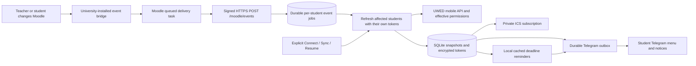

# Moodle Calendar delivery plan

## Decisions and current status

Build a multi-tenant Telegram assistant for regular students at `https://moodle.uwed.uz`, with each student's own Moodle token and a private ICS subscription for Google Calendar, Apple Calendar, or Outlook. Navigation uses emoji buttons; slash commands remain available for advanced controls.

**No periodic Moodle checks are allowed.** Website changes must arrive through an authenticated server event. Telegram long polling only receives Telegram messages; it is unrelated to Moodle updates. Local queue retries and cached deadline reminders do not discover website changes by repeatedly requesting Moodle.

Read-only login and assignment inspection succeeded with a real student account on **16 October 2026**. This validates that account's tested API access, rather than every student's permissions or all Moodle features. The server-event receiver and university-side bridge are prepared, but the bridge has **not been installed or activated at UWED**. Automatic production notifications and external-calendar refresh remain unvalidated.

The user has student access only. A student cannot install a Moodle plugin or enable outbound server events. UWED IT must review and install the included bridge before automatic website updates can operate. Until that happens, the app truthfully reports that it awaits a university event connection and uses explicit student refreshes. There is no polling fallback. Moodle documents event observers as plugin-defined subscriptions in `db/events.php`. [Moodle event observers](https://moodledev.io/docs/4.5/apis/commonfiles#dbeventsphp).

## Event architecture

The bridge observes supported write events, queues a minimal event envelope, and sends it from Moodle's task workers. The receiver verifies HMAC-SHA256 over `timestamp + "." + rawBody`, validates timestamp skew and payload, and durably accepts an event before acknowledging it. Accepted IDs are deduplicated. Per-student jobs coalesce affected events and retry failures; notifications are derived from a refresh through that student's token, never from untrusted envelope text or another student's grades.

An event targets affected connected students by course. Each refresh remains limited by the student's current API permissions. An unknown/global scope can require broader account refreshes. The mobile API is Moodle's supported external interface; access is role-dependent. [Moodle mobile services](https://docs.moodle.org/405/en/Mobile_web_services), [external-service overview](https://moodledev.io/docs/5.0/apis/subsystems/external).

Delivery latency includes Moodle cron/adhoc workers, receiver processing, API requests, and Telegram. Moodle supports retryable adhoc tasks, but this does not imply instantaneous delivery. [Moodle Task API](https://moodledev.io/docs/4.5/apis/subsystems/task). See [MOODLE_EVENTS.md](MOODLE_EVENTS.md) for the exact bridge contract, supported event allowlist, installation steps, and staging tests.

## Implementation behavior

1. **Private connection and baseline.** A one-time browser link exchanges username/password once or accepts an existing authorized token. The token is encrypted; passwords are not stored in SQLite. The first complete snapshot is silent. Reconnecting resets previous account preferences, timetable, completion marks, and calendar secrets.
2. **Event-driven changes.** A signed Moodle event creates durable jobs for affected students. Compare refreshed normalized metadata with the saved baseline and queue supported new, updated, or no-longer-accessible notices. Preserve prior data when a required collection fails. Retries belong to an accepted event job; no new requests are scheduled merely to look for changes.
3. **Truthful assignment availability.** Keep submission state separate from availability. Outstanding work can be open, upcoming, restricted, closed, or unknown. Use Moodle's effective permission/access result with opening time, cutoff, and conditional restrictions. A final-submit button alone does not determine whether a student can edit a draft. Do not classify future or inactive work as urgent.
4. **Next deadline per course.** The nearest future assignment deadline defines the course's current group, including tied deadlines. Submitting early does not advance that group until its deadline passes. Accessible unfinished overdue work stays visible. Later and undated assignments appear separately, outside current priorities, reminders, and calendar deadlines. This planning rule does not claim to detect teacher release. Moodle exposes assignment timing and user status separately. [Moodle assignment API source](https://raw.githubusercontent.com/moodle/moodle/MOODLE_405_STABLE/mod/assign/externallib.php).
5. **Useful cached views.** Today/week, priorities, preparation, and calendar views use saved eligible items. Future/restricted/closed/unknown assignments remain visible in their assignment grouping but are excluded from active priorities, preparation tasks, reminders, and calendar deadlines. Personal done marks affect the assistant, while submission and grading remain Moodle states.
6. **Calendar and timetable.** Private revocable ICS URLs expose eligible dated work, Moodle events, and student-entered recurring classes. Providers control subscription refresh frequency; downloading the feed does not refresh Moodle. Manual classes use the student's timezone and a rolling 90-day feed window.
7. **Local reminders and delivery.** Evaluate cached active deadlines for 24-hour / 1-hour reminders. Suppress reminders when the saved state is unsuitable or stale. Keep the Telegram outbox durable and retry rate/transient failures; exactly-once delivery is not promised.

Node 24 runs native TypeScript; Fastify handles connection, calendar, Telegram, and Moodle event endpoints. SQLite holds tenant state, event jobs, and the notification outbox. Run one app instance. The built-in `node:sqlite` API is experimental in early Node 24 and a release candidate from 24.15 onward. [Node SQLite documentation](https://nodejs.org/download/release/latest-v24.x/docs/api/sqlite.html).

## Coverage boundaries

| Need | Initial behavior and limit |
| --- | --- |
| New lecture/seminar material | Supported write events trigger a refresh; compare exposed course/file metadata and provide Moodle links. Document contents are not read. |
| Assignments, quizzes, term controls | Read supported API objects available to the student. Custom UWED activity types may need another adapter. |
| Automatic notification of changes | Requires the installed server bridge. Unsupported events, edits without emitted events, and changes absent from API metadata can be missed. |
| Future tasks becoming available | Completion/submission/access-setting events can trigger reevaluation. A clock-only unlock may emit no event; the initial bridge does not schedule release-time reevaluation. Use the next relevant event or explicit Sync now. |
| Calendar | One-way private URL subscription. External providers may display changes hours after event processing; no two-way editing. |
| Multi-tenant | Students remain isolated on one UWED deployment; no shared teacher credential or per-student arbitrary Moodle hosts. |

## Required acceptance checks

- Prove an idle worker makes **zero Moodle requests**, including across repeated local reminder/outbox cycles. Menu views and calendar downloads must also use cache only.
- Reject wrong signatures, modified bodies, malformed events, and stale timestamps. Deduplicate repeated IDs and preserve durable jobs across restarts. A course event must not expose another student's data or refresh unrelated course tenants unnecessarily.
- Verify coalesced events, retry backoff, arrival during an active refresh, paused tenants, reconnect/disconnect behavior, and previous-snapshot preservation on failure.
- Compare assignment states with Moodle: open vs future, conditional restrictions, cutoff, unavailable/unknown access, group submissions, draft edit permissions, zero grades, extensions, and open assignments without due dates. Ensure inactive work never appears in priorities, reminders, or deadline feeds.
- Validate link expiry and reuse, student isolation, secret rotation, cached command replies, timezone/DST behavior, ICS escaping, and absence of credentials in logs/feed output.
- Run `npm run check` and `npm test`. Run the plugin's PHPUnit tests in a compatible Moodle/PHP environment separately; Node tests cannot validate a Moodle installation.
- After UWED installs the bridge in staging, connect two student accounts, create/edit an assignment, upload/replace a resource, change restrictions, submit/grade work, and confirm notices arrive without a student command. Check task failures/retries and compare the browser view.
- Subscribe a hosted feed in the selected calendar provider and measure its refresh delay. Validate backup restoration before production use.

## Remaining delivery stages

**University integration:** Give UWED IT the [bridge guide](MOODLE_EVENTS.md), plugin source, destination, and data-handling details. Provision a persistent HTTPS receiver with the shared signing secret. Complete staging compatibility and event coverage checks before enabling production. The current student account cannot complete this stage alone.

**Hosted pilot:** Use the prepared [Railway configuration](../railway.json) and [hosting guide](HOSTING.md), starting within Free/Trial credits. Credit limits mean free hosting cannot guarantee uninterrupted 24/7 operation. Run one instance with persistent storage, encrypted credentials, backups, and monitoring for event/job failures, queue age, delivery age, usage, and storage. Track the last accepted event separately from the last student refresh; a quiet site does not imply failure merely because time has passed. Validate actual upload/assignment notifications and calendar refresh with a few students.

**Later expansion:** Add one-off Moodle-side reevaluation for known future openings if required, without interval-fetch fallback. Move to PostgreSQL and a distributed durable queue before multiple workers. Add measured request budgets, formal key rotation, retention automation, localization, and configurable reminders. Add Google/Microsoft OAuth writes only if students need direct calendar updates beyond ICS subscriptions.
